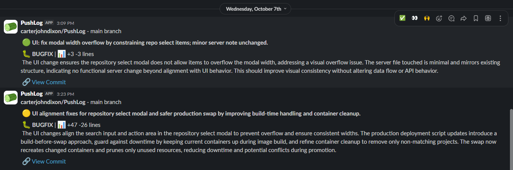
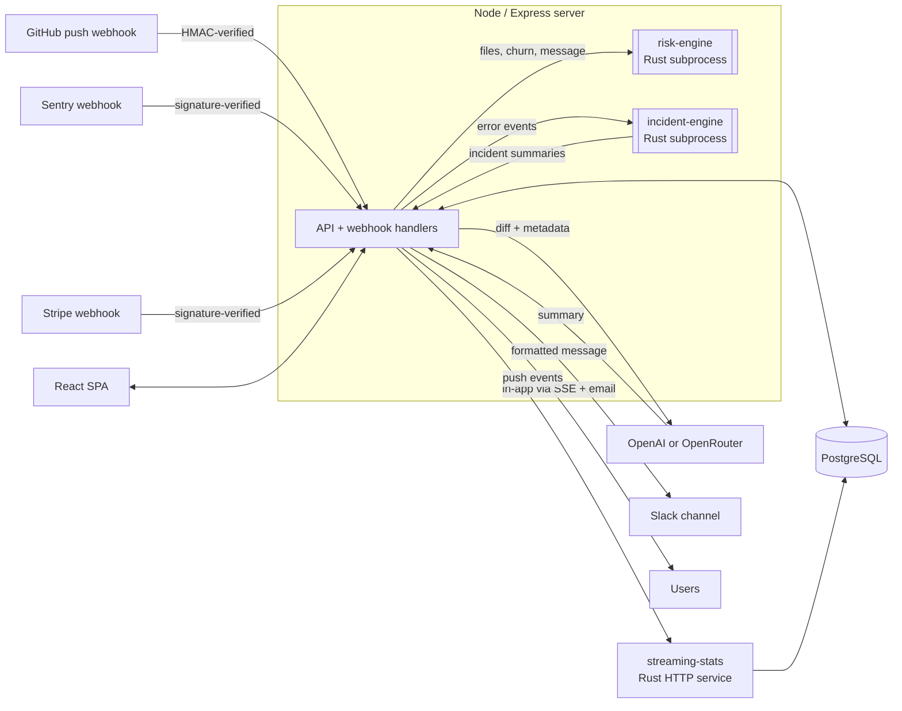

# PushLog

AI-written Slack summaries of your GitHub pushes, with Sentry incident alerts. Live at **[pushlog.ai](https://pushlog.ai)**.


## What it does

When you push to a connected GitHub repo, PushLog fetches the diff, scores how risky the change is, has an LLM write a short summary, and posts it to a Slack channel you choose. It also accepts Sentry webhooks, groups errors into incidents, links them to recent commits that may have caused them, and alerts your team in the app and by email.



## Architecture



**Push flow** (`server/githubWebhook.ts`): verify the `X-Hub-Signature-256` HMAC against the raw body → find the repo and integration → add a compact diff from the GitHub API → run the AI summary → post to Slack → save the push event, its risk score and AI usage/cost.

**Incident flow** (`server/sentryWebhook.ts`, `server/incidentEngine.ts`): verify the Sentry signature → send the event to the incident engine → the engine's summaries become in-app notifications (Server-Sent Events) and emails.

**Billing** (`server/stripe.ts`, `server/routes/billing.ts`): Stripe Checkout and subscription webhooks drive plans and AI credits. Billing is behind the `BILLING_ENABLED` flag.

### Why parts of it are in Rust

Three small Rust crates in a Cargo workspace (`Cargo.toml` at the root) handle the hot or stateful work, so the Node process stays a thin I/O layer:

| Crate | How it runs | What it does |
|---|---|---|
| [`server/risk-engine`](server/risk-engine) | Runs once per push: JSON in on stdin, JSON out on stdout | Rule-based impact score (0–100), risk flags (auth, deps, migration, secrets, payment…), change-type tags and hotspot files. No network, no DB. If it fails or times out, the push is saved without a score. |
| [`server/incident-engine`](server/incident-engine) | Long-running process that reads and writes one JSON object per line | Fingerprints errors (BLAKE3 over exception + top stack frames), keeps per-fingerprint EWMA baselines in memory, detects spikes, new issues and regressions, and ranks recent commits as likely causes. |
| [`server/streaming-stats`](server/streaming-stats) | Separate Axum HTTP service (its own container) | Updates precomputed daily aggregates in Postgres as each push arrives, so dashboard reads don't run heavy `GROUP BY` queries. |

Rust gives these predictable latency and low memory. It also keeps CPU-bound scoring and in-memory streaming state off Node's event loop, and the crates are easy to test on their own (`cargo test`). A fourth crate, `tools/pkg-compare`, diffs `package.json` dependencies so deploy scripts can skip `npm install` when nothing changed.

## Tech stack

- **Frontend:** React 18, TypeScript, Vite, Tailwind CSS, shadcn/ui (Radix), TanStack Query, wouter, Recharts
- **Backend:** Node.js 24, Express, TypeScript, Drizzle ORM (`postgres` driver), Zod
- **Rust:** Axum, Tokio, sqlx (Postgres), serde
- **Database:** PostgreSQL (Supabase in production, `postgres:16` container in staging); sessions stored in Postgres with `connect-pg-simple`
- **AI:** OpenAI API on PushLog's key (default `gpt-5.2`; also `gpt-5.1`, `gpt-4o`, `gpt-4o-mini` and Codex models), or bring your own [OpenRouter](https://openrouter.ai) key to use any OpenRouter model (e.g. `anthropic/claude-sonnet-4`)
- **Integrations:** GitHub (OAuth + webhooks), Slack Web API, Sentry, Stripe, Google OAuth, SMTP email (Nodemailer)
- **Infra:** Docker / Docker Compose on EC2, GitHub Actions

## Engineering highlights

- **CI** ([`ci.yml`](.github/workflows/ci.yml)): TypeScript typecheck and production build, plus Rust test/release builds for each crate.
- **Security scanning** ([`security.yml`](.github/workflows/security.yml)): CodeQL, Semgrep (OWASP + TS/JS rules), Gitleaks (secrets), `npm audit` (app and personal site), Trivy (deps, misconfig, secrets) and `cargo audit`. [`dependency-review.yml`](.github/workflows/dependency-review.yml) checks new dependencies on PRs, and [`zap-staging.yml`](.github/workflows/zap-staging.yml) runs an OWASP ZAP baseline scan against staging.
- **Staging and production in Docker:** `docker-compose.staging.yml` (app + Postgres + streaming-stats) and `docker-compose.production.yml`. They use multi-stage Dockerfiles with BuildKit cache mounts for fast Rust rebuilds, and containers run as non-root users.
- **Gated promotion to prod:** work lands in a personal repo. [`mirror-to-org.yml`](.github/workflows/mirror-to-org.yml) pushes to the org repo only after a required-reviewer approval, and production is promoted to a specific SHA from a staging admin page (`docker-compose.promote.yml`, `scripts/promote-production-docker.sh`).
- **Auth:** server-side sessions in Postgres (httpOnly cookies), bcrypt password hashing, GitHub and Google OAuth, email verification, TOTP two-factor with hashed recovery codes, Cloudflare Turnstile on login and signup, and org roles (owner/admin/developer/viewer).
- **Hardening:** Helmet, per-route rate limits (auth, password reset, payments, API), constant-time signature checks on GitHub/Slack/Sentry/Stripe webhooks, and AES-256-GCM encryption of stored third-party tokens.
- **Performance tooling:** DB indexes in [`scripts/db/`](scripts/db) and endpoint timing in `scripts/test-endpoint-timing.ts`.

## Running locally

**Prerequisites:** Node 24 (`.nvmrc`), PostgreSQL, and optionally a Rust toolchain for the engines.

```bash
git clone https://github.com/pushlog-ai/PushLog.git
cd PushLog
npm install

cp .env.example .env        # then fill in values; see comments in the file
npm run db:push             # create tables with drizzle-kit

# Optional: build the Rust engines (without them the server logs warnings and skips risk scoring / incidents)
cargo build --release -p risk-engine -p incident-engine -p streaming-stats

npm run dev                 # API + Vite dev server on http://localhost:5001
```

Minimum to boot: `DATABASE_URL`, `SESSION_SECRET` and `ENCRYPTION_KEY`. GitHub, Slack and OpenAI credentials are needed for the push → summary → Slack flow. To receive GitHub webhooks locally, expose port 5001 with a tunnel (e.g. ngrok) and point your GitHub App's webhook URL at `/api/webhooks/github`.

Other useful commands:

```bash
npm run check               # TypeScript typecheck
npm run build               # production build into dist/
cargo test --workspace      # Rust tests
```

## Status

PushLog is live at [pushlog.ai](https://pushlog.ai) and I use it on its own development. As of October 2026 it has processed **802 GitHub pushes** in production, posted **799 Slack messages** and generated **732 AI summaries**. It doesn't have outside users yet.

## License

[PolyForm Noncommercial 1.0.0](LICENSE)

## Author

Built by Carter: [carter.pushlog.ai](https://carter.pushlog.ai)
